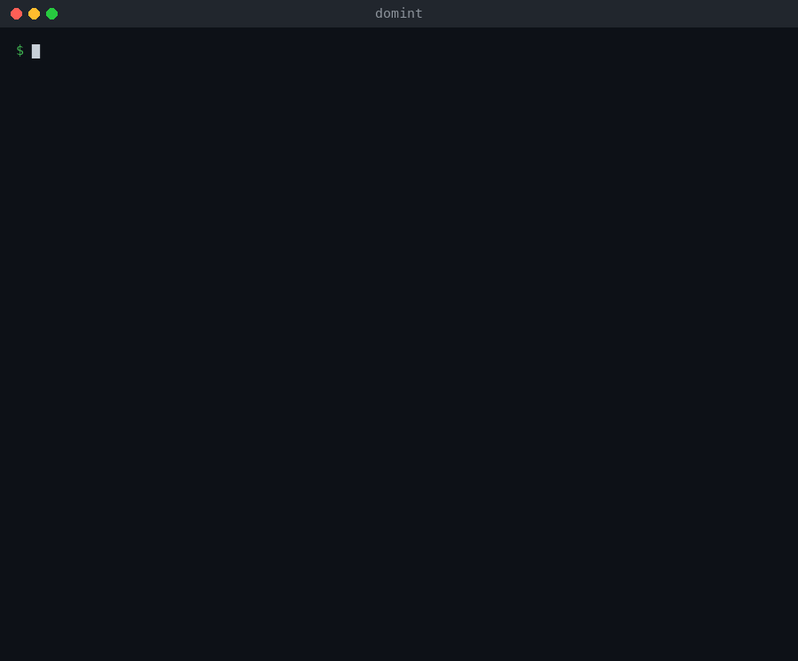

# domint

[](https://github.com/rudnikleandro/domint/actions/workflows/ci.yml)
[](LICENSE)


**Domain intelligence for threat-intelligence analysts.** Give domint a domain and it
answers the first questions of an investigation (who registered it and when, where it
is hosted, how its mail is protected, which subdomains and lookalikes exist, what threat
feeds say about it) in one readable report, with every claim traceable to the query that
produced it.

It is **passive by default**: only third-party sources are asked (registries, resolvers,
Certificate Transparency, threat feeds), so the target never sees your IP unless you ask
for it with `--active`.



## What it checks

| Module | Flag | What you learn |
|---|---|---|
| Registration | `-w` | Registrar, dates, age, status, privacy service (RDAP, falling back to WHOIS) |
| Addresses | `-a` | IPs, reverse DNS, network (ASN), hosting and CDN in front of it |
| DNS | `-d` | NS, MX, SPF, DMARC, CAA, DNSSEC, SOA, TXT, mail and DNS providers, SaaS verification tokens |
| TLS | `-t` | Certificate issuer, validity, trust, and the other names it covers |
| HTTP | `-H` | Status, redirects, server banner |
| Subdomains | `-s` | Names from Certificate Transparency and passive DNS, their CNAMEs, and with `--active`, which ones answer |
| Reputation | `-r` | AlienVault OTX pulses; abuse.ch URLhaus, ThreatFox, Spamhaus DBL and SURBL with a free key |
| Lookalikes | `-l` | Typosquatting: which of ~1000 variants (homoglyphs, typos, other TLDs, phishing words) are registered and can receive mail |

Every module runs by default except `-l`, which costs about a thousand DNS queries.
Pick modules to run only those, and combine them: `-wd`, `-sl`.

## Signals it raises

The report starts with what matters, ranked by severity:

- **Subdomain takeover risk**: an alias (CNAME) pointing to a deleted Azure, Heroku, GitHub Pages or S3 resource that anyone can claim
- **Lookalike domains** that can receive mail (the setup used for phishing and invoice fraud), set apart from parked, for-sale and the owner's own defensive registrations
- **Threat-feed listings** on ThreatFox, URLhaus, Spamhaus DBL, SURBL and OTX
- **Young domains** and newly issued first certificates
- **Mail spoofing exposure**: missing or weak SPF and DMARC
- **Exposed environments**: dev, staging and admin hosts that answer, open directory listings
- **Stale DNS**: names a CDN still answers for without serving anything
- **Infrastructure leads**: shared addresses, other domains on the same certificate, domains that share indicators when you investigate several

When a source fails, the report says so in a **Gaps** line, so a missing value reads as
"unknown", not as "none".

## Install

Needs a C compiler and the libcurl headers.

```sh
# Debian / Ubuntu
sudo apt-get install build-essential libcurl4-openssl-dev
# macOS: the Xcode command line tools already include libcurl
xcode-select --install

make
sudo make install        # installs to /usr/local/bin
```

## Usage

```sh
domint example.com                  # everything but lookalikes, passive
domint -l example.com               # lookalike domains only
domint -wd example.com example.org  # registration and DNS of two domains, then what they share
domint --active --full example.com  # also contact the target; show every collected value
domint -f domains.txt -o report.txt # domains from a file (one per line, # for comments)
domint hxxps://example[.]com/login  # URLs and defanged indicators are accepted
```

| Output | Flag |
|---|---|
| Summary, signals and gaps | *(default)* |
| Every collected value | `--full` |
| Every query made, with the raw answers (audit trail) | `--raw` |
| JSON for scripts and SIEMs, with an indicators block (domains, IPs, lookalikes) | `-j` |
| STIX 2.1 bundle for OpenCTI, MISP and other platforms | `--stix` |

A default run:

```text
SUMMARY
  Signals       2 info
  Registered    1995-08-14 (31 years, 3 months ago), RESERVED-Internet Assigned
                Numbers Authority
  Hosting       AS13335 CLOUDFLARENET - Cloudflare, Inc., US
  DNS provider  Cloudflare
  Mail          accepts no mail (null MX)
  Reputation    no listings in OTX; OTX marks it known-good
  Subdomains    1 discovered (not probed; --active checks which answer)

SIGNALS
  [INFO]   Served through Cloudflare, which hides the origin server's real
           address.
  [INFO]   No CAA record: any certificate authority may issue certificates for
           this domain.
```

### STIX 2.1

`--stix` writes a bundle with `domain-name`, `ipv4-addr`, `ipv6-addr` and
`autonomous-system` observables linked by `resolves-to` and `belongs-to` relationships,
an `indicator` for each registered lookalike and each threat-feed listing, a `note` with
the signals and a `report` that groups them. Observable ids are derived from their values
as the specification requires, so importing the same domain twice merges instead of
duplicating. The bundles pass the OASIS
[stix2-validator](https://github.com/oasis-open/cti-stix-validator).

### API keys

All optional, read from the environment:

| Variable | Effect |
|---|---|
| `ABUSECH_AUTH_KEY` | Enables URLhaus and ThreatFox ([free key](https://auth.abuse.ch)) |
| `OTX_API_KEY` | Raises the AlienVault OTX rate limit |

## Operational security

- Passive mode asks registries, resolvers, crt.sh, OTX, HackerTarget, Team Cymru and abuse.ch. None of them is the target.
- DNS lookups go through your resolver (or `--resolver`), which sees the names you investigate; the target's own nameservers see the resolver, not you.
- `--active`, `-t` and `-H` connect to the target and its subdomains from your IP. The report header says which mode ran.
- Text from the network is sanitized before it reaches your terminal: a threat-feed entry or a WHOIS record cannot inject escape sequences.

## Testing

```sh
make test                   # unit tests, no network needed
make fuzz                   # mutation fuzzing of every parser and report writer, with ASan and UBSan
make fuzz FUZZ_RUNS=300000  # a longer run
```

CI builds and runs both on Linux (gcc) and macOS (clang) for every push.

## Limitations

- A domain whose sources fail (crt.sh is often overloaded) gets an incomplete subdomain list; the Gaps line says which.
- Lookalike checks use DNS alone: "registered" means delegated, not who registered it.
- Internationalized (IDN) names are not accepted as input.

## License

[MIT](LICENSE)
